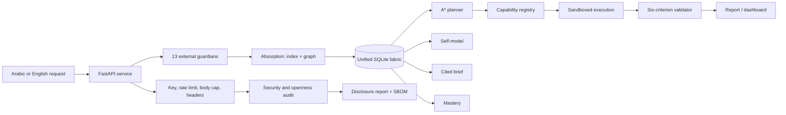

# Architecture

## Layers

1. **Guardianship**: adapters for arXiv, OpenAlex, Semantic Scholar, Crossref,
   GitHub, Hacker News, Hugging Face, PyPI, npm, Wikipedia, Stack Overflow,
   Zenodo, and a local corpus. A dead source degrades the result; it does not
   fail the run.
2. **Fabric**: one SQLite store for knowledge units, the concept graph,
   capability versions, an append-only event log, a source cache, and a failure
   memo.
3. **Planning and synthesis**: A* over capability types, blueprint acquisition,
   enumerative program synthesis, and a subprocess gate.
4. **Execution and validation**: serial/thread/process execution with measured
   speedup; six scores and an overclaim detector.
5. **Introspection**: a self-model that plans its own claims, lexical claim
   support, randomized property checks, and confidence intervals.
6. **Openness**: a static scanner, licence inventory, OSV lookup, CycloneDX
   SBOM, a public disclosure report, and a threat model. API guards add an
   optional key, a per-client rate limit, a body cap, and security headers.

## Data flow

A request is consulted, absorbed, planned, executed, validated, and recorded.
The self-model and mastery table read the same event log. The security audit
reads the source tree and the dependency metadata; it never reads user data.
