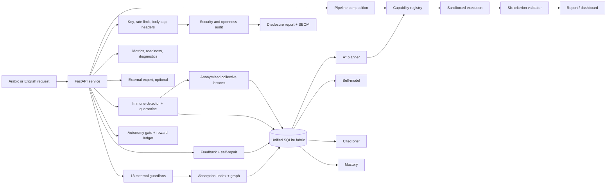

# Architecture

## Layers

1. **Guardianship**: adapters for arXiv, OpenAlex, Semantic Scholar, Crossref,
   GitHub, Hacker News, Hugging Face, PyPI, npm, Wikipedia, Stack Overflow,
   Zenodo, and a local corpus. A dead source degrades the result; it does not
   fail the run.
2. **Expert guardianship**: optional OpenAI-compatible experts return unverified
   text candidates; they are never executed and never receive the store.
3. **Fabric**: one SQLite store for knowledge units, the concept graph,
   capability versions, an append-only event log, a source cache, and a failure
   memo.
4. **Planning and synthesis**: reachability proof plus A* over capability types,
   bounded capability pipelines, blueprint acquisition, enumerative program
   synthesis, and a subprocess gate.
5. **Execution and validation**: serial/thread/process execution with measured
   speedup, bounded media header readers, and graph path/rank; six scores and an
   overclaim detector.
6. **Introspection**: a self-model that plans its own claims, lexical claim
   support, randomized property checks, confidence intervals, outcome feedback,
   and a self-repair path for broken built-in entries.
7. **Immunity and collective memory**: an online statistical anomaly score with
   a bounded quarantine and in-memory learned path hashes, plus a strict
   anonymized lesson export/import format.
   The autonomy gate checks autonomy, continuity, safety, and collective
   contribution; the reward ledger is an inspectable event score, not RL.
8. **Openness and operations**: a static scanner, licence inventory, OSV lookup,
   CycloneDX SBOM, a public disclosure report, and a threat model. API guards add
   an optional key, a per-client rate limit, a body cap, security headers, and a
   short immune quarantine;
   `/metrics`, `/ready`, and `/diagnostics` expose process health without secrets.

## Data flow

A request is consulted, absorbed, planned, executed, validated, and recorded.
The self-model and mastery table read the same event log. The security audit
reads the source tree and the dependency metadata; it never reads user data.
